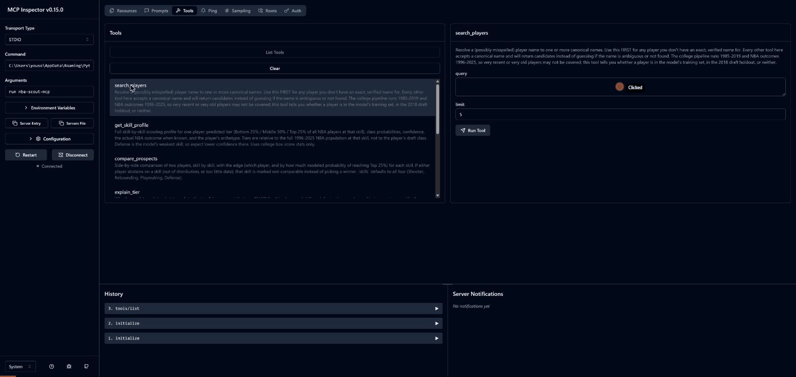

# nba-scout-mcp

An MCP server that lets AI agents consult a published NBA draft-scouting
model like a human scout, including when not to trust it.



*Recorded against the real server through the MCP Inspector: the 2018 Playmaking board surfacing Aaron Holiday, Jevon Carter, and Landry Shamet as undervalued relative to their draft picks, then a nonsense stat line triggering the abstain rule on all four skills. A natural-language version through Claude Desktop is an easy follow-up; see [Recording the demo](#recording-the-demo) below.*

## Why

I'm the first author of "Shopping by Skill: A Skill Vectorization Index
for NBA Draft and Roster Construction" (MIT Sloan Sports Analytics
Conference 2026, Basketball Track, paper ID 171), which reached the final
review round of the Research Papers Competition. The paper trains
per-skill tier classifiers (Shooting, Rebounding, Playmaking, Defense)
on pre-draft college box scores and evaluates them against a 2018 draft
holdout.

A published model is only useful to an agent if the agent can ask it
questions mid-task and trust the answer appropriately. This project
packages the research as an MCP server: an agent calls a tool, gets a
structured judgment with its reasoning, and gets an honest confidence or
abstain signal when the model shouldn't be trusted. The part that matters
most here isn't the accuracy number. It's the server telling the agent
when *not* to trust it.

## Quickstart

```powershell
git clone https://github.com/haddadyousef/nba-scout-mcp
cd nba-scout-mcp
uv sync
uv run python scripts/export_artifacts.py   # ~100 minutes on a laptop CPU; see below
uv run nba-scout-mcp                        # starts the stdio MCP server
```

`export_artifacts.py` re-fits the four skill models (5-fold CV, SMOTE,
HistGradientBoosting/XGBoost/RandomForest + a soft voting ensemble) and
writes everything the server needs under `artifacts/`. It only needs to
run once. `artifacts/` isn't checked into git (the trained models run to
~25MB each; see `.gitignore`), so this step is required after a fresh
clone. It needs nothing beyond the two CSVs already in `data/`: no
scraping, no network calls.

### Claude Desktop config

```json
{
  "mcpServers": {
    "nba-scout": {
      "command": "uv",
      "args": ["run", "--directory", "C:\\path\\to\\nba-scout-mcp", "nba-scout-mcp"]
    }
  }
}
```

### MCP Inspector

```powershell
npx @modelcontextprotocol/inspector uv run nba-scout-mcp
```

## Tools

| Tool | What it does |
|---|---|
| `search_players(query, limit=5)` | Fuzzy-resolve a (possibly misspelled) name to canonical player(s); says whether they're in training, in the 2018 holdout, or neither. |
| `get_skill_profile(player)` | Full profile: tier, class probabilities, confidence, actual NBA outcome when known, archetype. |
| `compare_prospects(player_a, player_b, skills=None)` | Side-by-side with a per-skill edge, or "can't compare" if either side abstains. |
| `explain_tier(player, skill)` | SHAP top-5 feature contributions, raw values + training percentiles, archetype + centroid distance, 3 nearest comps with actual tiers. |
| `draft_class_board(year=2018, skill=None, top_n=15)` | Ranks the (genuinely held-out) 2018 class by modeled P(Top 25%); draft pick sits next to model rank so "undervalued" is visible. |
| `find_comps(player, k=5)` | Nearest neighbors in archetype (PCA) space, with actual outcomes. |
| `project_custom_prospect(stats, name)` | Scores a stat line that isn't in the database, through the same saved scaler/clustering/model. |
| `get_model_card()` | Data, features, per-skill accuracy, known limitations. Also at the `scout://model-card` resource. |

Resources: `scout://model-card`, `scout://archetypes`. Prompt:
`scouting_report(player)`.

Every tool returns the same envelope:

```json
{
  "answer": { "...tool-specific payload..." },
  "summary": "One or two plain-English sentences an agent can quote directly.",
  "confidence": "high | medium | low | abstain",
  "confidence_reasons": ["top-class probability 0.81", "inside training distribution"],
  "caveats": ["Defense is the model's weakest skill (see model card)."],
  "provenance": {
    "prediction_type": "out_of_fold | holdout | new_input",
    "model_version": "svi-2026.1+<git sha>",
    "data_through": "college 1985-2019, NBA outcomes 1996-2025"
  }
}
```

## How the trust layer works

A model that reports a tier with no sense of its own reliability isn't
useful to an agent making a decision. Four rules, implemented in
[`trust.py`](src/scout_mcp/trust.py):

- **high**: top-class probability >= 0.70 and the input is inside the
  training distribution.
- **medium**: top-class probability 0.50-0.70, or a skill with known weak
  accuracy (Defense).
- **low**: top-class probability < 0.50, or the top two classes are
  within 0.10 of each other.
- **abstain**: the input is out of distribution: its distance to the
  nearest archetype centroid exceeds the 97.5th percentile of training
  distances, or more than 2 required stats were missing or imputed. An
  abstain still returns the archetype and nearest comps; the tier itself
  is `null`.

And the rule that matters more than any threshold: **no training-set
player is ever served an in-sample prediction.** Every historical player
gets an out-of-fold prediction (scored by a model that never saw them
during training); every 2018 draft-class player gets a genuine holdout
prediction (excluded from training entirely); anything else is a fresh
input scored through the saved pipeline. `tests/test_no_leakage.py`
enforces this and fails the build if it's ever violated.

## What's different from the published pipeline, and why

The published pipeline (`vendor/predict_success.py`, from
[haddadyousef/NBA-Draft-prediction](https://github.com/haddadyousef/NBA-Draft-prediction))
is a research script, not something built to be served. Two things in it
don't hold up for a server that has to tell an agent when to trust a
prediction, so `scripts/export_artifacts.py` fixes them:

1. **There's no real 2018 holdout.** `college_stats_final.csv` has no
   season column, so the published pipeline trains on all 1,268 merged
   players, the 2018 draft class included. The "2018 case study" story
   in the paper comes from a separate, never-published script that scores
   the 2018 board with zero-filled cluster features instead of the fitted
   ones. For this server, the 32 players from the 2018 class who have
   college stats are excluded from training entirely, so their
   predictions are a genuine forecast.
2. **`sti_probabilities.csv` isn't out-of-fold for most players.** The
   published training loop keeps only the single best-accuracy fold per
   model (each fold overwrites the last), covering roughly a fifth of
   players, and its accuracy number is a cherry-picked best-of-5. This
   server aggregates held-out predictions across all 5 folds, so every
   training-set player gets exactly one real out-of-fold prediction, and
   the accuracy below is the honest fold average.

Two smaller, deliberate simplifications, both to keep this a weekend
build rather than a model-improvement project (which is explicitly out of
scope, see below): no `GridSearchCV` (fixed hyperparameters instead) and
no TVAE/CTGAN synthetic augmentation (SMOTE only, which is the technique
the paper actually attributes most of its class-imbalance handling to).
The per-skill K-means/PCA clustering that feeds the models is also fit
once on the training population and persisted, instead of refit per fold
and discarded, and the published pipeline never saves it, which makes it
impossible to score a new player consistently (`vendor/README.md` has the
full list of differences).

## Model card summary

Re-run on this repo's data, `export_artifacts.py`, commit
`b0db46844007a939bfc9d644f613b8815e6f10a4` of the research repo, dated
2026-11-19. Full card via `get_model_card()` / `scout://model-card`.

| Skill | Served model | Fold-averaged CV accuracy | Paper's claim |
|---|---|---|---|
| Shooter | voting ensemble | 64.4% | 65-75% |
| Rebounding | voting ensemble | 71.0% | 65-75% |
| Playmaking | HistGradientBoosting | 66.6% | 65-75% |
| Defense | HistGradientBoosting | 52.0% | not claimed (flagged as weakest) |

Shooter lands just under the paper's range; Rebounding and Playmaking
land inside it; Defense is weak, exactly as the paper itself flags. These
are fold-averaged numbers from a real re-run, not the paper's numbers
restated. See "What's different" above for why a cherry-picked best-fold
number would have read higher.

**2018 holdout, worth calling out honestly:** of the 32 members of the
2018 class with college stats, 2 (including Trae Young) land outside the
abstain threshold and the server correctly abstains on them: his college
usage/assist/turnover profile is a genuine statistical outlier even among
high-usage guards. That's the trust layer doing its job, not a bug; it
does mean this server's holdout doesn't reproduce the paper's "confirmed
Trae Young" line item under honest out-of-distribution checking. Jalen
Brunson, Kevin Huerter, and Landry Shamet do reproduce the paper's
"undervalued" story: run `draft_class_board(2018, "Playmaking")` and all
three rank well ahead of where they were actually picked.

5 archetypes come out of PCA + K-means over 12 standardized college
stats, fit on the full 1,268-player population (unsupervised, so the
holdout split doesn't apply). See `scout://archetypes` for descriptions
and example players.

**Known limitations:**
- College box-score stats only. No measurements, no film, no injury
  history.
- Tiers are relative to the full 1996-2025 NBA outcome population, not to
  a player's own draft class.
- The 2018 holdout only covers players who played NCAA basketball before
  the draft (32 of 60 picks); the rest have no college stats to score.
- `School` in the source CSV is a scraping artifact (it holds a mangled
  copy of the player's own name, not their school), so `conference` is
  the only clean "where they played" field for most players; real college
  names are only available for the 2018 holdout class, from public draft
  records.

## Architecture

```
nba-scout-mcp/
  pyproject.toml
  config.py                 # thresholds, paths, model version
  data/                      # the two input CSVs + the 2018 draft board
  vendor/                    # unmodified copy of the published pipeline, for citation
  scripts/
    export_artifacts.py      # the only place training happens
  src/scout_mcp/
    server.py                # MCP tools, resources, prompt; thin adapter
    engine.py                # ScoutEngine: loads artifacts, predicts/explains/compares
    trust.py                 # confidence + abstain rules
    features.py               # feature engineering shared by export and engine
    names.py                  # fuzzy player resolution
  artifacts/                  # generated by export_artifacts.py, not committed
    skill_models/{skill}.joblib
    preprocess.joblib
    oof_predictions.parquet
    players.parquet
    player_features.parquet
  tests/
  evals/
  ts-harness/                  # TypeScript MCP client running the golden eval suite
  .github/workflows/ts-harness.yml
```

`server.py` holds no ML logic; everything is in `engine.py` so it can be
tested without the MCP protocol in the loop (`tests/test_engine.py` does
exactly that). Artifacts load once at process start: no training,
scraping, or network calls happen at request time. Every response
carries a `model_version` with the git commit it was built from.

## TypeScript client

[`ts-harness/`](ts-harness/) is a second MCP client, written in
TypeScript against the official `@modelcontextprotocol/sdk`, that spawns
the server over stdio and runs the same golden checks (draft board,
abstain, ambiguous name, envelope schema via zod) independently of the
Python test suite:

```powershell
cd ts-harness
npm install
npm run start
```

`.github/workflows/ts-harness.yml` runs this, plus the Python test suite,
on every push. Training the 4 skill models takes about 100 minutes on a
plain CPU runner, so CI caches `artifacts/` by a hash of the inputs that
actually change it and only retrains on a cache miss.

## Recording the demo

`docs/demo.gif` was recorded through the MCP Inspector, which exercises
the real server over the real stdio transport, just with raw tool forms
instead of an agent's natural language. A second, arguably better clip is
easy to add once the server is wired into Claude Desktop (steps above),
since that's a natural-language agent actually choosing tools rather than
a human filling in a form:

1. Ask: *"Using the scout tools: in the 2018 draft, which second-round
   pick did the model think was a top playmaking prospect? Then compare
   him to Trae Young on playmaking and shooting, and tell me how
   confident the model is."* Expected tool sequence: `draft_class_board`
   → `compare_prospects` → `explain_tier`.
2. For a second clip: give it a nonsense stat line (e.g. 40 three-point
   attempts per game on 60% shooting) via `project_custom_prospect` and
   show it abstain, with the reason.

## Out of scope

- Scraping current college players live (`project_custom_prospect`
  covers a prospect you found elsewhere).
- Retraining or improving the model. This project is about serving and
  trusting a model that already exists, not chasing accuracy.
- A web UI, auth, or a hosted deployment. Stdio and local only for now:
  remote HTTP transport (`mcp.run(transport="streamable-http")`) is the
  obvious next step if this needs to run somewhere other than a laptop.

## What I'd build next

An expert-feedback tool: a human scout overrides a tier, the override is
logged with its reason, and over time it becomes a second "lens" the
agent weighs against the model. That's the direct analogue of encoding
and licensing expert judgment for agents to consult, which is what this
whole exercise is testing in a second domain.
